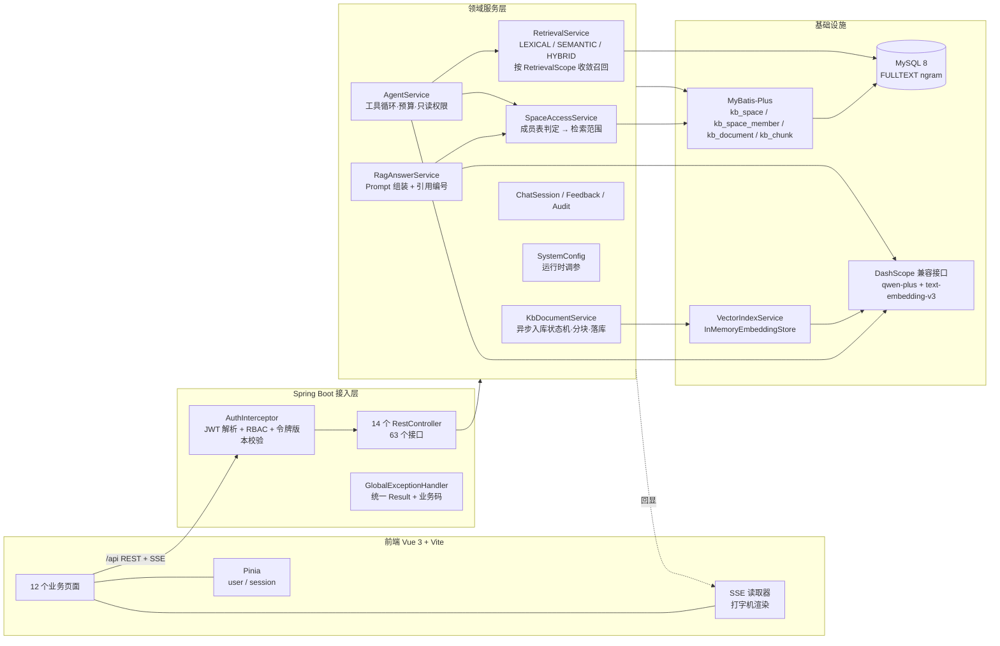
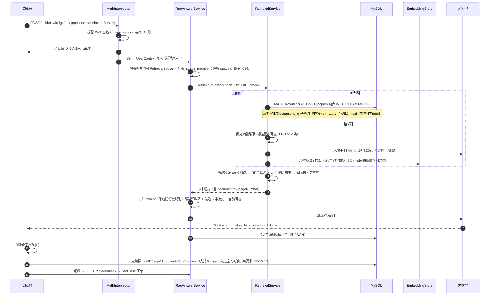

<div align="center">

# 私有知识库问答系统（RAG）

**面向中小团队的私有化知识库构建与智能问答平台** —— 文档入库、混合检索、可溯源问答、质量治理一体化

Spring Boot 3.5 · Java 21 · MyBatis-Plus · MySQL 8 · LangChain4j · Vue 3.5 · Vite 8 · Element Plus

</div>

---

> 一个人的全栈毕业设计，但按工程标准做：分层与依赖注入、统一异常码、RBAC 与令牌吊销、空间级数据权限、
> 异步入库状态机、230 条自动化测试、可复现的检索评测跑批、CI 与容器化脚本。
> README 里每一个数字都来自代码统计或真实跑批日志，跑不出来的一律标注「未验证」。

## 目录

- [它解决什么问题](#它解决什么问题)
- [30 秒跑起来](#30-秒跑起来)
- [12 个功能模块](#12-个功能模块)
- [系统架构](#系统架构)
- [文档异步入库：上传快、解析稳](#文档异步入库上传快解析稳)
- [一次提问的完整链路](#一次提问的完整链路)
- [知识库智能体：从固定 RAG 到工具调用](#知识库智能体从固定-rag-到工具调用)
- [检索评测：真实数字](#检索评测真实数字)
- [词法召回性能优化：LIKE 全表扫描 → FULLTEXT](#词法召回性能优化like-全表扫描--fulltext)
- [并发压测与语义路冷启动](#并发压测与语义路冷启动)
- [安全加固清单](#安全加固清单)
- [工程指标](#工程指标)
- [关键设计决策](#关键设计决策)
- [目录结构](#目录结构)
- [配置项](#配置项)
- [数据库迁移](#数据库迁移)
- [已知限制](#已知限制)

## 它解决什么问题

企业内部资料散落在 PDF、Word、Wiki 里，员工查不到、大模型又不知道。把文档切块向量化之后套一层
大模型，就是最常见的 RAG 方案。但 demo 和能用之间差着几件事，这个项目就是把这几件事补齐：

| 常见 RAG demo 的问题 | 本项目的做法 |
| --- | --- |
| 答完就忘，不知道依据哪段资料 | 回答带 `[1]` 角标，点开就是**原文 PDF 的第几页**并高亮命中句 |
| 只有一路向量检索，专有名词/参数名反而召回差 | **词法 + 语义双路召回，RRF 融合**，并提供检索实验室现场对比三路结果 |
| 检索效果全靠主观感受 | 自建标注问题集，跑批输出 Hit@1/3/5、MRR、P95 耗时、切片粒度敏感度 |
| 答得不好没人管 | 赞/踩 → 自动生成 BadCase 工单 → 管理员在反馈台改切片或调参数，形成闭环 |
| 幻觉挡不住 | 系统提示词强制「只依据资料区作答，资料不足必须明确说不知道」，mock 模式可离线自测 |
| 谁都能看所有文档 | JWT + RBAC 角色、按用户隔离会话、文档预览权限与令牌吊销；**知识库空间是权限边界**，没授权的账号在召回 SQL 里就取不到那个空间的切片 |

## 30 秒跑起来

### 环境要求

JDK 21+、Maven 3.9+、MySQL 8.0、Node.js 22+。大模型密钥可选（不填也能跑通问答链路，见下文 mock 模式）。

### 1. 建库

```bash
mysql -uroot -p --default-character-set=utf8mb4 < backend/src/main/resources/db/schema.sql
```

脚本会创建 `kb_rag` 库、9 张表和种子账号（`admin / admin123`、`student / 123456`）。
已有老库则按顺序手工执行 `backend/src/main/resources/db/migration/V*.sql`（见 [数据库迁移](#数据库迁移)）。

> MySQL 的 `ngram_token_size` 必须是默认值 2。词法召回按中文 2-gram 切词，全文索引要用同一口径才命中，
> 这条约束写在 `V8__lexical_fulltext.sql` 的头部注释里。

### 2. 后端

密钥不写进代码。新建 `backend/src/main/resources/application-local.yml`（已在 `.gitignore` 内）：

```yaml
spring:
  datasource:
    password: 你的MySQL密码
auth:
  # 生成一条：openssl rand -hex 32
  secret: 至少32字节的随机串
rag:
  api-key: 你的DashScope密钥   # 留空不会自动演示；离线体验需另外设置 mock-enabled: true
```

```bash
cd backend
mvn spring-boot:run        # 默认 8080
mvn test                   # 230 条测试，连 H2 内存库，不需要 MySQL
```

### 3. 前端

```bash
cd frontend
npm ci
npm run dev                # http://localhost:5173，/api 由 Vite 代理到 8080
```

浏览器打开 <http://localhost:5173>，用 `admin / admin123` 登录，先到「知识库与文档管理」上传一份
PDF。上传接口落盘入队后立即返回，列表状态会从 `PENDING` → `PARSING` → `INDEXED`，状态变成
`INDEXED` 后就能在「AI 智能问答台」提问；失败的行可以直接点「重新解析」。

### 4. Docker（脚本已就绪，未实机验证）

```bash
cp .env.example .env      # 填 MySQL 密码、JWT 密钥
docker compose up -d --build
# 前端 http://localhost:5080，首次启动自动执行 schema.sql 建库
```

> 诚实说明：开发机没有安装 Docker，`backend/Dockerfile`、`frontend/Dockerfile`、`docker-compose.yml`
> 与 `nginx.conf` 按官方镜像约定编写并通过 YAML 语法校验，但**尚未在真实 Docker 里构建运行过**。
> 首次实跑可能要调整的点已在文件注释里标出（健康检查依赖 `curl`、MySQL 初始化脚本只在空卷执行）。

### 演示录屏

`assets/demo.gif`（待录制）。建议录制顺序：登录 → 上传 PDF 看解析进度 → 问答台提问 →
点 `[1]` 角标跳到原文页码并高亮 → 检索实验室三路对比 → 点踩生成 BadCase → 反馈台处理并调参。
可用 ScreenToGif（Windows 免费）或 `ffmpeg` 截取。

## 12 个功能模块

| 分组 | 模块 | 路由 | 权限 | 说明 |
| --- | --- | --- | --- | --- |
| 概览 | 数据监控大屏 | `/dashboard` | ADMIN | ECharts 实时指标：文档量、召回耗时、问答量趋势、系统健康 |
| 知识资产 | 知识库与文档管理 | `/knowledge` | ADMIN | 空间分组、成员授权、上传解析进度、切片列表、启用/停用、原文预览 |
| 知识资产 | 检索对比实验室 | `/Laboratory` | ADMIN | 同一问题并发跑词法/语义/混合三路，逐条显示名次、分数、耗时差 |
| 知识资产 | 全局切片语料中心 | `/corpus` | ADMIN | 跨文档检索切片、直接改正文、停用即同步移出向量库 |
| 问答服务 | AI 智能问答台 | `/chat` | 登录用户 | SSE 逐字输出、多轮上下文、角标溯源到原文页码、赞踩反馈、检索范围可选自己有权限的知识库 |
| 问答服务 | 知识库智能体 | `/agent` | 登录用户 | 原生工具调用、多轮检索与片段读取、工具记录实时追加、90 秒硬超时、可主动取消、空间权限继承 |
| 问答服务 | 提示词模板市场 | `/templates` | 登录用户 | 系统内置 + 个人模板，一键套用到输入框 |
| 系统管理 | 问答质量反馈 | `/feedback` | ADMIN | BadCase 工单：待处理/处理中/已解决，关联原问题与切片 |
| 系统管理 | 问答审计日志 | `/audit` | ADMIN | 每次问答的召回策略、耗时、引用数全记录，支持 CSV 导出 |
| 系统管理 | 用户与权限管理 | `/users` | ADMIN | 增删改用户、改角色、重置密码（会立刻吊销其现存 token）；新建 USER 账号自动进默认知识库空间 |
| 系统管理 | 引擎参数配置 | `/settings` | ADMIN | topK / RRF k / 语义阈值 / 切分粒度 / 系统提示词，即时生效 |
| 账号中心 | 个人中心 | `/profile` | 登录用户 | 资料修改、改密码、退出登录（服务端真吊销）、我的模板 |

## 系统架构



存储选型上有两个刻意的「不引外部依赖」：向量库用 LangChain4j 的 `InMemoryEmbeddingStore`
序列化成本地 JSON，重启自动加载，无需 Milvus/ES；全文索引直接用 MySQL 自带的 `FULLTEXT ... WITH PARSER ngram`。
`pom.xml` 里已经预留 `langchain4j-milvus` 依赖，量级上来可平滑替换（见 [已知限制](#已知限制)）。

## 文档异步入库：上传快、解析稳

PDFBox 抽取、分块、向量化都是 CPU / 内存密集型操作，放在 Tomcat 请求线程里会让大文件上传长期占住连接。
现在上传只做「校验 → 建文档行 → 落盘 → 入队」，其余交给独立线程池：

```text
POST /api/documents/upload
  └─ PENDING（已落盘，等待解析）
       └─ PARSING（后台线程原子领取）
            ├─ INDEXED（切片落库 + 空间计数重算 + 向量写入）
            └─ FAILED （保留 errorMsg，可重新解析）
```

- **原子领取与删除竞态**：状态切换全部用 `UPDATE ... WHERE status = 期望值` 的条件更新，重复投递或多实例同时消费只有一个能成功；
  文档在解析中被删除时，切片落库事务会因条件更新 0 行而整体回滚，不留孤儿切片。
- **事务边界**：`INDEXED` 状态、切片批量写入、空间 `doc_count/chunk_count` 重算在同一个事务里提交；
  向量写入放在事务提交之后，旧向量清理同样遵循「先改库、再删向量」。
- **有界队列 + 明确失败**：线程数 `RAG_INGEST_THREADS`、队列 `RAG_INGEST_QUEUE_CAPACITY` 可配，队列满返回业务码 `5005`
  并把文档标为 `FAILED`（写着「队列已满」），不会无界堆任务把内存吃光。
- **失败重试**：`POST /api/documents/{id}/reindex` 清空旧切片与向量后重新入队；文档仍在 `PENDING/PARSING` 返回 `4090`，
  原文文件丢失返回 `4041`。
- **重启恢复**：启动完成事件扫描 `PENDING/PARSING` 文档，`PARSING` 先条件退回 `PENDING` 再重新入队；
  原文缺失的直接标 `FAILED` 并写明原因，避免进程崩溃后文档永久卡在「解析中」。

前端不自动轮询：列表显示「待处理 / 解析中」状态与当前页处理中的数量提示，用户点「刷新」查看进度；
`FAILED` 行提供「重新解析」按钮。后台时序由新增的 5 条集成测试用可捕获任务的假线程池确定性验证，
上传即返回、队列满、重试、启动恢复与「向量化阶段异常不得回滚已提交切片」都有覆盖，
不依赖 `Thread.sleep` 猜执行时机。

## 一次提问的完整链路



## 知识库智能体：从固定 RAG 到工具调用

普通问答按「检索一次 → 生成」固定执行；`POST /api/agent/ask` 把三个只读工具交给模型，
接收 LangChain4j 原生 `tool_calls`，执行后以匹配调用 ID 的 `ToolExecutionResultMessage` 回灌，
模型可继续改写关键词、查看目录或读取片段，也可给出最终回答。不是从自然语言中解析命令。
同一套执行逻辑另有流式入口 `POST /api/agent/ask/stream`，页面默认走流式，同步接口保留给脚本与旧客户端。

```json
{"question":"查找滑动窗口相关文档，并根据片段解释工作机制","spaceId":1,"maxSteps":4,"taskId":"a1b2c3d4"}
```

`spaceId` 可省略，表示当前账号全部可见空间；`maxSteps` 为模型轮数（含最终回答），默认 4、最大 5。
响应包括 `answer`、`steps`（工具名、参数、观察结果、成功状态、耗时）、去重的 `citations`、
`modelCalls`、`stopReason` 和 `mock`。页面展示的是**实际工具记录，不是模型隐藏推理**。
`citations` 是工具已读取的来源证据，不保证模型逐条引用，按文档名和片段核对。

| 工具 | 参数 | 服务端约束 |
| --- | --- | --- |
| `search_knowledge` | `query`，可选 `limit` | 最多 5 段，沿用混合检索与空间范围，只返回已索引文档中的启用片段 |
| `list_documents` | 可选 `keyword`、`limit` | 最多 10 篇，只列范围内已索引的未删除文档 |
| `read_chunks` | `documentId`，可选 `startIndex`、`limit` | 起始索引从 0 开始，最多 5 段；直接猜 ID 也必须通过相同空间校验 |

模型无权传入新空间、SQL、URL 或文件路径；未知参数、非法类型、畸形 JSON 都返回工具错误供模型修正。
单任务最多 8 次工具调用、单条正文最多 1200 字符，引用按文档 ID + 片段序号去重；
无工具证据时不放行模型直接生成的答案；模型判定检索片段与问题无关时也按无证据处理，并清空引用列表。
未完成、达到预算、模型异常均以明确的 `stopReason` 返回，不能把它们当成成功回答。
全局最多 4 个并发任务，同账号最多 1 个，超额业务码为 `4290`，不排无界队列。
每次工具调用重查成员关系，任务返回前还会复核权限范围，期间权限改变则拒绝返回旧观察结果。

### 执行控制：硬超时、取消与实时步骤

一次 Agent 运行可能连续调用多次模型，供应商 HTTP 调用一旦挂住，仅靠「轮次之间检查剩余预算」挡不住。
P2 把执行层拆成三件事：

- **独立线程池 + 看门狗。** `agentExecutor`（默认 4 线程 / 队列 32 / `AbortPolicy`）只跑工具循环，
  `agentWatchdog`（单线程调度）只负责到点收尾，两者都与异步入库、问答 SSE 隔离。队列满直接返回 `4290`，
  不把任务甩回 Tomcat 请求线程。
- **90 秒硬超时。** 同步接口用 `Future.get(agentTimeoutMillis)`；流式接口在提交时注册看门狗。
  到点后先由 `AgentTask.publish()` 以 CAS 抢占终态并组装已有步骤，再取消 Future、打断 worker、释放并发名额。
  顺序不能反：worker 被中断后可能先发布 `CANCELLED`，会把真实的超时原因覆盖掉。
  终态返回 `stopReason=TIME_LIMIT`，已有步骤照常返回、`answer` 写明未完成，不会伪装成成功回答。
- **可取消与断连回收。** `POST /api/agent/tasks/{taskId}/cancel` 只允许任务所属账号操作；
  不存在、不属于自己、已结束统一返回 `data=false`，避免用取消接口枚举任务 ID。
  页面关闭或网络断开时 `SseEmitter` 回调立即取消任务并释放名额，不留下继续调用模型的孤儿任务。
  超时/取消组装结果前会重新执行 `scopeForCurrentUser` 复核权限，期间被移出空间则返回 `4030`，不返回旧观察。

流式协议是 `meta → step → done`（异常走 `error`）：`meta` 带服务端认可的 `taskId`、`mock`、`maxSteps` 与
`timeoutMillis`；每完成一次工具调用推送一条 `step`；`done` 才携带完整 `AgentAskResponse`。
**这是步骤级流式，不是逐字输出答案**——最终回答仍一次性到达，页面在等待区实时追加工具记录，
并显示剩余预算与「离开页面会取消本次任务」。取消后结果区明确标注「任务已取消 · 未完成」，
已有工具记录与引用仅供排查，不当成答案。

**验证边界：** 离线测试用脚本化 `ChatModel` 验证多轮协议、错误恢复和权限，不代表真实模型的任务成功率。
`rag.mock-enabled=true` 时仅执行一次固定词法检索（不调用对话或向量模型），响应明确标记 `mock=true`，不能把这个分支宣传成自主规划。
2026-10-20 用 `qwen-plus` 对现有 2 篇文档、5 个切片做了一轮真实模型冒烟评测，共 15 项：
9 道可回答题全部 `COMPLETED` 且有引用，答案覆盖预期要点；无答案题最初因「检索返回了无关片段」被误标为完成，
已改为模型判定片段无关时返回 `NO_EVIDENCE` 并清空 citations，修复后复跑为 `NO_EVIDENCE`、0 引用；
提示词注入未泄露密钥；空间越权 `4030`、空问题 `4001`、匿名访问 `401` 均符合预期。
样本小、单次运行，**不构成统计显著性结论**，也不能替代真实任务集评测。
P2 新增 4 条流式/取消测试与 1 条独立硬超时测试（超时档把预算压到 300ms，验证不是靠 `sleep` 猜时序），
全量 **230 条通过、0 失败、0 跳过**；
`vue-tsc` 与 `vite build` 通过。P2 流式/取消链路用真实 `qwen-plus` 验收：SSE 依次收到 `meta → step → done`，
同步复跑返回 `modelCalls=2`、3 条工具记录、3 条引用、`COMPLETED`、7,246ms；运行中调用取消接口返回 `data=true`，
最终 `stopReason=CANCELLED`、3 条工具、2 次模型调用、3,060ms。浏览器内实测完整运行 11,029ms / 5 条引用，
取消后页面显示「任务已取消 · 未完成」，无 console 错误。
像素级布局验收已改用外部 Headless Chrome + CDP 完成：12 个模块 × 1280/1440 两档共 24 个组合，
水平溢出、越界元素、文本裁切与 console 异常均为 0；期间发现并修复设置页滑块刻度与说明文字重叠、首个刻度被卡片裁切的问题。
V9 已落真实 `kb_rag`（`kb_space_member` 回填 2 行），未修改业务数据。

### Agent 文件级改动清单

仅列智能体模块的文件，不包含检索、入库、权限等其它批次的改动。

| 文件 | 职责 |
| --- | --- |
| `backend/src/main/java/com/bishe/kb/controller/AgentController.java` | `POST /api/agent/ask`、`/ask/stream`、`/tasks/{taskId}/cancel` |
| `backend/src/main/java/com/bishe/kb/model/dto/AgentAskRequest.java` | 问题、空间、模型轮数、客户端 taskId 校验 |
| `backend/src/main/java/com/bishe/kb/model/vo/AgentAskResponse.java` | 工具记录、证据、明确停止原因 |
| `backend/src/main/java/com/bishe/kb/service/AgentService.java` | 同步、流式、取消三个服务入口 |
| `backend/src/main/java/com/bishe/kb/service/impl/AgentServiceImpl.java` | 模型/工具循环、流式事件、并发闸门、权限复核 |
| `backend/src/main/java/com/bishe/kb/service/impl/AgentTask.java` | CAS 单次终态、看门狗、并发名额释放 |
| `backend/src/main/java/com/bishe/kb/service/impl/AgentRunState.java` | 请求内状态、证据去重、轮次间时间预算 |
| `backend/src/main/java/com/bishe/kb/service/impl/AgentKnowledgeTools.java` | 三个只读工具及空间/状态过滤 |
| `backend/src/main/java/com/bishe/kb/service/impl/AgentToolArguments.java` | 严格 JSON 参数白名单与类型、长度、范围校验 |
| `backend/src/main/java/com/bishe/kb/service/impl/AgentToolCatalog.java` | 模型使用的原生工具 schema |
| `backend/src/main/java/com/bishe/kb/config/AsyncConfig.java` | `agentExecutor` 与 `agentWatchdog` 独立线程池 |
| `backend/src/test/java/com/bishe/kb/AgentIntegrationTest.java` | 工具协议、SSE 步骤、取消、权限复核回归（45 条） |
| `backend/src/test/java/com/bishe/kb/AgentConcurrencyTest.java` | 并发拒绝、异常释放与未登录直调测试（4 条） |
| `backend/src/test/java/com/bishe/kb/AgentTimeoutIntegrationTest.java` | 300ms 独立档硬超时终态（1 条） |
| `frontend/src/api/agent.ts` | 同步/流式请求、SSE 分帧、取消接口 |
| `frontend/src/views/AgentView.vue` | 提问、实时步骤、取消、错误与空状态 |
| `frontend/src/views/AgentRunResult.vue` | 结果、证据与取消态展示，禁止模型生成外链/图片 |
| `frontend/src/views/AgentToolTrace.vue` | 实际工具参数与观察日志，运行中实时追加 |
| `frontend/src/router/index.ts` | `/agent` 懒加载路由，侧栏同步显示 |
| `README.md` | 模块、接口、指标、验证边界及本清单 |

## 检索评测：真实数字

评测跑批用的是**生产同一段召回代码**（`RetrievalServiceImpl`），语料与切片全部写进 H2 内存库，
不接触任何真实数据。完整报告：[docs/evaluation/experiment_report.md](docs/evaluation/experiment_report.md)。

数据集：80 段知识切片（网络协议 / 操作系统 / 数据库 / 系统架构 / Java 与 JVM / 分布式与中间件 各 10 段，
安全与认证 / 检索与大模型 / 前端工程 / 数据结构与算法 各 5 段，共 18321 字、平均 229 字/段）+
92 道人工标注问题（A 类 28 / B 类 35 / C 类 29）。80 段全部被至少一题覆盖，
每条 `evidence` 证据串在整份语料中只出现一次，避免跨切片假命中。
三类问题与目标切片的平均字面重合度实测 A 类 46.30%、B 类 17.94%、C 类 26.73%——
B 类只有 A 类的 0.39 倍，「同义改写题没有字面可依」是可核对的构造事实，不是主观描述。

### 实验一：检索策略消融（评测窗口 Top-10，n=92）

| 检索策略 | Hit@1 | Hit@3 | Hit@5 | MRR | 平均耗时 | P95 耗时 | Top5 平均字数 |
| --- | --- | --- | --- | --- | --- | --- | --- |
| 纯词法（2-gram LIKE） | 56.52% | 76.09% | 81.52% | 0.669 | 16.9 ms | 28 ms | 1173 |
| **纯语义向量** | **76.09%** | **86.96%** | **91.30%** | **0.821** | 141.1 ms | 201 ms | 1132 |
| 混合双路 + RRF(k=60) | 70.65% | 86.96% | 90.22% | 0.799 | 152.5 ms | 221 ms | 1161 |
| **混合双路 + RRF + gte-rerank-v2 精排（生产链路）** | **90.22%** | **95.65%** | **96.74%** | **0.932** | 140.0 ms | 190 ms | 1125 |

**这组数字和我原本的预期不一样，所以我把它如实写出来**：题量从 30 扩到 92、语料从 20 段扩到 80 段之后，
混合检索**不再总体压过语义路**（Hit@1 低 5.43 个百分点、MRR 低 0.022）。按类别拆开才看得清它到底赢在哪：

| 类别（题数） | 词法 Hit@1 | 语义 Hit@1 | 混合 Hit@1 | 混合 Hit@5 | 解读 |
| --- | --- | --- | --- | --- | --- |
| A 字面精确（28） | 71.43% | 89.29% | 82.14% | 100.00% | 80 段候选池里每个术语基本只出现在自己那段，向量等价地完成了精确匹配 |
| B 同义改写（35） | 48.57% | 57.14% | 51.43% | **82.86%** | 唯一「混合同时超过两路」的类别：MRR 0.663 > 语义 0.645 > 词法 0.579 |
| C 综合复杂（29） | 51.72% | 86.21% | 82.76% | 89.66% | 语义单路就够，融合不再带来名次收益 |

逐题层面（Top-5 口径，92 题）更直白：**只有词法路**做到的 4 题（B4、B5、B18、B32），
**只有语义路**做到的 13 题，两路都掉出名额的 4 题里混合**救回 1 题**（B24）；
同时混合相对最优单路**退后 11 题**——这就是 RRF 的代价：叠加弱信号的同时也会把一路的强命中拉平。
所以对这套系统的准确表述是：**混合不是「全面最优」，而是不让任何一类题彻底失效的保险费**
（三类里最差的 Hit@5 从词法 68.57%、语义 80.00% 抬到 82.86%），
报告第 3.3 节与第 5 节把这两个方向都自动写成了带数值的结论，没有挑好听的只说一半。

上表前三行是**关闭精排的 RRF 基线消融**；第四行才是线上真正跑的「双路召回 → RRF 粗排 → gte-rerank-v2 Cross-Encoder 精排」生产链路。
正是看到 RRF-only 混合在总体 Hit@1 上仍低语义路 5.43pp，才引入精排补齐：精排后总体 Hit@1 90.22%、Hit@5 96.74%、MRR 0.932，
全面超过语义单路（76.09% / 91.30% / 0.821）与 RRF-only 混合，其中 B 类同义改写 MRR 增量最大（0.663 → 0.856）。
本批 92 题精排 0 降级；精排超时/报错会按题自动回退 RRF 粗排，问答主链路不中断（报告 3.4 节如实记录降级题数）。

### 实验二：切片窗口敏感度（混合策略）

| 粒度 max/overlap | 切出片段 | Hit@1 | Hit@5 | MRR | 平均耗时 | Top5 平均字数 |
| --- | --- | --- | --- | --- | --- | --- |
| 200 / 30 | 162 | 59.78% | 84.78% | 0.705 | 144 ms | 758 |
| **500 / 75** | 58 | **65.22%** | 90.22% | **0.761** | 150 ms | 1770 |
| 800 / 120（生产默认） | 31 | 64.13% | **91.30%** | 0.754 | 140 ms | 3293 |
| 1200 / 180 | 24 | 61.96% | 90.22% | 0.745 | 135 ms | 4793 |

三点读法：

1. **200 档是明确的最差档**——一条完整知识被切分边界拆散后，问题向量只能与局部内容相似，
   混合 Hit@1 从 65.22% 掉到 59.78%；碎片化省不了 Prompt 字数，只是把上下文切碎。
2. **MRR 峰值在 500/75（0.761），不在生产默认的 800/120（0.754）**。我没有跟着数字改默认值，
   理由有两个：差距只有 0.007、在 92 题的样本量上远够不到显著性；而 800 档的 Hit@5（91.30%）是四档最高、
   改粒度意味着已入库文档要整库重切重向量化。取舍写进了报告第 5 节第 3 条，而不是藏起来。
3. **Prompt 成本随粒度单调上升**（758 → 4793 字，6.3 倍），命中率却是先升后降，
   所以「大切片召回更全」这类说法站不住——1200 档 Top-5 塞进 4793 字，MRR 反而比 500 档低 0.016。

另一个只在实验二出现的现象值得记下：混合检索在**四档真实分块粒度**上的 Hit@1 全部高于两路单策略
（如 800 档：混合 64.13% > 语义 56.52% > 词法 55.43%），而实验一的整段语料上却不是。
说明分块越碎、单段语义越不完整时，双路互补才真正显出价值——这也符合直觉：片段越短，
词法硬特征越能补向量的模糊。

复现：

```bash
cd backend
mvn -o test -P benchmark -Dtest=RetrievalBenchmarkTest
# 报告与 CSV 输出到 docs/evaluation/，需要真实 embedding 密钥，耗时约 2.6 分钟（92 题 × 3 策略 × 5 档语料）
```

## 词法召回性能优化：LIKE 全表扫描 → FULLTEXT

**问题**：初版词法召回对每个检索词跑一次 `LIKE '%词%'`。一句中文问题会被 `buildTerms()` 洗成
最多 12 个检索词（英文按空格、中文额外切 2-gram），于是单次召回要发 12 次 `LIKE`；而 MyBatis-Plus 的
`selectPage` 在取数据前还要先发一条 `COUNT`——**每个问题 24 条全表扫描 SQL，任何索引都用不上**。
语料只有几十段时毫无感觉，语料上万段就会直接把检索拖成秒级。

**改法**：换成一条 MySQL 全文检索，`OR` 语义、相关度打分、排序截断全在 SQL 里完成，命中走
`ft_chunk_content (content) WITH PARSER ngram`（ngram_token_size=2，与代码里的 2-gram 口径一致）：

```java
// RetrievalServiceImpl.lexicalRetrieve
if (props.isFulltextLexical()) {
    try {
        return chunkMapper.searchByFulltext(booleanExpression(terms), topK);   // 一条 SQL
    } catch (RuntimeException e) {
        log.warn("全文索引词法召回失败，本次退回 LIKE：{}", e.getMessage());    // 兜底不中断
    }
}
return likeRetrieve(terms, topK);                                              // 降级路径
```

三点设计值得说明：`rag.lexical-mode` 可切回 `like`（H2 不支持 `MATCH ... AGAINST`，测试与压测对照组要用）；
索引被误删或语法不受支持时**自动退回 LIKE**，宁可慢也不让问答断掉；`booleanExpression()` 会把
`+ - > < ( ) ~ * " @` 这些 BOOLEAN MODE 操作符洗掉，避免脏词改变整条 SQL 的语义。

**压测结果**（临时库 `kb_rag_bench`：**103,680 条切片 / 19.5 MB 数据**，与生产同构、含 ngram 全文索引；
取评测集 A/B/C 三类各前 10 题共 30 道真实问题，每个模式 3 个有效样本 × 30 题 = 90 个样本，第 1 轮作预热丢弃；
计时在 MySQL 会话内用 `now(6)` 前后差取得，含每条语句的客户端往返，SQL 形态与
`RetrievalServiceImpl` 逐字一致。这轮压测跑在评测集扩容到 92 题**之前**，题干与现在的 A1–A10/B1–B10/C1–C10
完全相同（已逐条核对），只是当时还没扩题量——LIKE 单题 5.7 秒的量级不会因题量变化而改变。
P50/P95 按 `values[int(p × (n-1))]` 取秩、不插值，与脚本 `summarize()` 一致）：

| 词法召回路径 | 平均检索词 | 每题 SQL 条数 | P50 | P95 | 均值 |
| --- | --- | --- | --- | --- | --- |
| 逐词 LIKE（含 MyBatis-Plus 分页 COUNT） | 12.0 | **24.0** | 5772.97 ms | 6079.70 ms | 5737.96 ms |
| `MATCH AGAINST` + ngram 全文索引 | 12.0 | **1** | **13.72 ms** | 220.62 ms | 71.92 ms |
| 提升 | | 24× → 1× | **416.8×** | **27.6×** | **79.8×** |

读法上有三点要说明，否则这组数字容易被高估：

1. LIKE 路径 5.7 秒不是「优化前后差一点」，是**量级上根本不可用**——它必须在 19.5 MB 的正文上做
   24 次前后都带通配符的扫描，任何索引都用不上，而语料只会继续变大。
2. FULLTEXT 的 P95（220 ms）明显高于 P50（13.7 ms），原因是「一次顺序读」「索引下推」这类
   高频 2-gram 会在倒排索引里命中上万条文档，取并集与打分开销随之上升；这也是为什么词表要做
   去重与上限 12 的截断。
3. 这组数字是 SQL 层实测。评测跑批与自动化测试仍在 LIKE 路径上（H2 不支持 `MATCH ... AGAINST`），
   所以上面实验一里的 16.9 ms 词法耗时是 80 段语料的 LIKE 结果，两者口径不同、不可直接比较。

复现：

```bash
mysql -uroot -p --default-character-set=utf8mb4 < docs/bench/lexical_load_setup.sql   # 灌 10 万条
MYSQL_PWD=你的密码 python docs/bench/lexical_ab_probe.py --mysql "mysql.exe 路径"       # A/B 计时
mysql -uroot -p --default-character-set=utf8mb4 < docs/bench/lexical_load_teardown.sql # 清理临时库
```

执行计划层面的差异也一目了然：

```text
-- MATCH ... AGAINST：走倒排索引，按词项直接定位文档
type: fulltext   key: ft_chunk_content   rows: 1   Extra: Using where; Ft_hints: sorted

-- content LIKE '%词%'：enabled=1 这个索引几乎不筛掉任何东西，剩下逐行判断
type: ref        key: idx_chunk_enabled  rows: 51015   Extra: Using where
```

明细数据：[docs/bench/lexical_ab_results.csv](docs/bench/lexical_ab_results.csv)（180 行，每题两轮各 3 个样本）。

## 并发压测与语义路冷启动

这一节量的是「多个人同时点会怎样」和「第一句提问为什么要等十几秒」，与上一节的单条 SQL 口径互补。
脚本：[docs/bench/api_concurrency_probe.py](docs/bench/api_concurrency_probe.py)，明细：
[docs/bench/concurrency_results.csv](docs/bench/concurrency_results.csv)。

### 服务端并发（本机 Spring Boot + MySQL，只读接口）

压的是三个只读、且不碰大模型的接口（跑完不留脏数据、不产生 token 费用）。每档先预热 1s 再采样 6s，
每个压测线程持有自己的 keep-alive 连接，成功判定是「HTTP 200 且业务 `code == 0`」双重口径：

| 接口 | 并发 1 | 并发 4 | 并发 8 | 并发 16 | P95（并发 16） | 错误率 |
| --- | --- | --- | --- | --- | --- | --- |
| `/api/health` 不查库 | 2,588 | 5,879 | 5,846 | 5,822 QPS | 5.4 ms | 0% |
| `/api/chunks/page` 语料检索分页 | 214 | 862 | 1,739 | 2,654 QPS | 7.1 ms | 0% |
| `/api/dashboard/stats` 大盘统计 | 189 | 865 | 1,520 | 1,885 QPS | 9.8 ms | 0% |

三条曲线形状不一样，各有各的解释：

1. **health 从并发 4 起就不再涨**（5.8k QPS 封顶），而 P50 从 0.6ms 线性升到 2.5ms——排队了但没崩。
   这个上限很可能是压测客户端自己先到顶：Python 线程 + GIL 在纯本地回环上就是几千 QPS 的量，
   **不能当成服务端容量结论**，只能说明「本机服务在这个压力下没有垮、错误率 0%」。
2. **两个查库接口近似线性到并发 8**（214→1,739 是 8.1×，189→1,520 是 8.0×），到 16 变成 1.53×/1.24×
   的亚线性增长——这已经能看到池子在收口（Tomcat 线程、Druid 连接、CPU），不是无限可加。
3. 16 并发下最慢的 P99 也只有 10.9ms，问答链路的体验瓶颈从来不在这一层，而在大模型往返。

**口径要交代清楚**：真实库只有 80 段语料，所以这组数字反映的是「鉴权 + MyBatis + 分页 COUNT + JSON」
这套服务栈的固定开销，不代表大数据量下的检索表现；量级那一头看上一节 10.3 万切片的 SQL 实测。

### 语义路首查：22 秒 → 171 毫秒 → 2 毫秒

改造前语义召回第一次要等 **22,360ms**，第二次仍然慢。定位下来慢的不是向量计算，
而是**每个问题都要出一次公网**，其中首请求还要额外承担 DNS + TLS 握手 + 连接池建立。三处对症改动：

- **启动预热**（`EmbeddingWarmUpRunner`）：监听 `ApplicationReadyEvent`，在虚拟线程上发一次轻量
  embedding 请求把连接建好。实测日志 `向量链路预热 完成：模型=text-embedding-v3 维度=1024 耗时=564ms`，
  启动 0.6s 后就绪，不阻塞端口暴露，也不占用 SSE 线程池。
- **问题向量 LRU**（`rag.embedding-query-cache-size`，默认 512 条 ≈ 3MB）：同一个模型对同一句问题的
  向量是确定性的，重复提问只有「要不要再花一次公网往返」的差别。key 带模型名，换模型不会复用旧语义空间；
  句子先 `trim` 再进 key，句首尾空白的两种写法共用一个位置。
- **超时从 60s 收到 20s 且可配**：问答侧的向量回不来就让词法路顶上，而不是把用户挂在 SSE 连接上干等。

本机实测（预热已过、同一进程、同一分钟内连打三次同一问题）：

| 次序 | 语义路耗时 | 整次请求 | 出网次数 |
| --- | --- | --- | --- |
| 第 1 次（缓存未命中） | 171 ms | 212.8 ms | 1 |
| 第 2 次（同问题，命中缓存） | 2 ms | 39.8 ms | 0 |
| 第 3 次（同问题 + 尾随空格） | 3 ms | 15.9 ms | 0 |

第 2、3 行是缓存生效的直接证据，第 3 行还顺手证明了归一化在真实链路上起作用；单元测试
`QuestionEmbeddingCacheTest`（9 条用例）用会数调用次数的假模型把「第二次不再出网」钉成回归防线。
**这不是受控 A/B**：单次网络计时抖动大，171ms 与 22,360ms 之间还夹着服务端排队等不可控因素，
但量级差和「命中缓存后不再出网」是确定的。

### 前端构建产物：首屏 JS 从 972KB 降到 39KB

`import * as echarts from 'echarts'` 会把 25 种图表、全部组件和两种渲染器一起拽进大屏路由分包
（1,125.88 kB），而这里其实只画一条折线和一个饼图。改成 `echarts/core` 按需注册六件事
（CanvasRenderer / LineChart / PieChart / Grid / Tooltip / Legend），再按「多久变一次」给三方库分组：

| 构建产物 | 改前 | 改后 |
| --- | --- | --- |
| 入口 `index.js`（首屏必下） | 972.25 kB | **39.07 kB**（gzip 15.47） |
| 大屏路由 chunk | 1,125.88 kB | **8.87 kB** |
| echarts 运行时 | 含在上面 | 529.69 kB，**只在进大屏时下载** |
| element-plus | 含在入口 | 1,039.78 kB 独立 chunk，业务改版不再让它重下 |
| vite 大 chunk 告警 | 2 条 | 0 条（阈值抬到 1100KB 并在配置里写明理由） |

## 安全加固清单

按「攻击者视角」逐条处理，每条都有对应测试（`SecurityHardeningIntegrationTest` 等）：

| 风险 | 处置 |
| --- | --- |
| 上传 HTML 后管理员预览 → 存储型 XSS 拿管理员 cookie | 白名单删掉 `html/htm`，即使历史文件是 HTML 也按 `text/plain` 返回，并带 `X-Content-Type-Options: nosniff` |
| 遍历文档 id 读任意原文（IDOR） | 非管理员要过两层：文档所属空间必须在自己的可见集合里，且状态为 `INDEXED`；未入库或越权草稿一律 4030 拒绝 |
| 普通用户前端传任意 `spaceId` → 越权召回别人空间的切片 | 空间从「管理员选的过滤条件」升级为「按账号判定的权限边界」：`kb_space_member` 成员表 + 授权判定前置于召回，范围下推进三路 SQL（单空间 / 可见集合 / 拒绝一切），不在内存里挑 |
| 可见空间为空时 `IN ()` 语法错误或退化成全库 | 空集合在服务层直接短路成「拒绝一切」，SQL 里永远不会出现空 `IN`；用「无任何成员的账号」用例守住这条下限 |
| JWT 密钥写死在代码里 → 任何人可伪造管理员 token | `auth.secret` **不给默认值**，缺失时 `JwtUtil` 构造器直接让应用启动失败 |
| 改密码/被重置/主动退出后旧 token 仍可用 | `sys_user.token_version` 递增即作废此前签发的全部 token，拦截器每请求比对，不一致返回 401/4012 |
| 同一用户对同一条回答重复点踩 → 重复工单 | `unique(message_id, user_id)` + 捕获 `DuplicateKeyException` 后合并到既有工单 |
| 批量停用切片时向量库反复全量序列化 | 改成一次批量删除 + 单次落盘，`persist()` 加锁防并发写坏 JSON |
| 密钥进仓库 | `.gitignore` 拦 `application-local.yml` 与 `.env`；CI 里再加一道硬编码 `sk-` 字面量扫描 |

## 工程指标

| 维度 | 数值 |
| --- | --- |
| 后端 | 152 个 Java 文件 / 10,824 行，14 个 Controller / 63 个接口，9 张表 |
| 自动化测试 | 23 个默认执行的测试类 / **230 条用例全绿**（测试源码共 26 个文件 / 8,308 行，含 1 个默认排除的 benchmark 跑批类与 2 个辅助类；H2 内存库 MODE=MySQL 复刻生产表结构，不起 Docker 也不碰真实库） |
| 前端 | 13 个路由页面（含登录）+ 2 个 Agent 子视图 / 40 个 ts+vue 文件 / 10,732 行，TypeScript 严格模式，`vue-tsc` 零错误，`vite build` 零告警 |
| 性能实测 | 只读接口 16 并发 2,654 QPS / P95 7.1ms / 错误率 0%；10.3 万切片下词法召回 P50 13.72ms；语义路首查 171ms、复用 2ms |
| 依赖 | Spring Boot 3.5.16、Java 21、MyBatis-Plus 3.5.17、LangChain4j 1.22.0、PDFBox 3.0.8、Tika 4.1.0、jjwt 0.12.6 |
| CI | GitHub Actions：后端编译+全量测试、前端 `vue-tsc` 类型检查+构建、密钥与 DDL 体检 |
| 数据库脚本 | `schema.sql` 全量 + `V2~V9` 增量 + H2 测试版三份保持同步 |

## 关键设计决策

**1. 双路召回用 RRF 融合，而不是给两路分数加权。**
词法路的分数是「命中词数」，语义路的分数是余弦相似度，两者量纲不同、不可比。RRF 只看名次：
`score = Σ 1/(k + rank)`，k=60 是学界与工程通用默认。好处是任何一路加了新打分方式都不用重新调参，
实现也只有十几行（`addRrfScores`）。代价也要说清楚：平滑是双向的，一路强命中会被另一路的弱命中拉平，
92 题实测混合的总体 Hit@1 反而低于语义路 5.43 个百分点（见「检索评测」与「已知限制」）。

**2. 语义召回的最低相似度阈值设为 0，只做名次截断。**
调过 `semanticMinScore` 之后同义改写题的召回明显改善：绝对分数会因文本长度而系统性偏低，
用统一阈值过滤等于把 B 类题全丢掉。宁可在融合阶段靠 RRF 排掉，也不在召回阶段用分数一刀切。

**3. 全文检索失败自动降级，不抛给用户。**
`match ... against` 依赖索引存在与 `ngram_token_size=2`。生产库里索引被人删掉、或者换到不支持的
数据库时，捕获异常退回 LIKE 路径并打 warn。可用性优先于「干净的错误」。

**4. 向量库一期用 `InMemoryEmbeddingStore` + 本地 JSON。**
毕设规模（万级切片）下，引入 Milvus/ES 的运维成本远大于收益。序列化落盘、重启加载、
删除同步清理，接口层只依赖 `EmbeddingStore` 抽象，后续换 Milvus 只改装配不改业务代码。
并发写 JSON 会写坏文件，所以 `persist()` 用独立锁对象串行化。

**5. 原文预览用文件流 + HTTP Range，而不是转图片。**
`GET /api/documents/{id}/preview` 返回 206 分段响应，浏览器内嵌 PDF 渲染器可以直接
`#page=N` 跳页——这是「点角标跳到原文那一页」体验的基础。放弃 CSP sandbox 是经过测试的取舍：
加了 sandbox 后 Chrome 内置 PDF 查看器的页内跳转会失效，而白名单已禁止 HTML，风险面已经收敛。

**6. 评测数据集分 A/B/C 三类，并计算「字面重合度」。**
把「语义检索有用」从主观判断变成可量化事实：B 类题与原文重合度只有 17.94%，是 A 类（46.30%）的
0.39 倍，词法召不回是结构性的，命中率差距就只能归因于向量。同时评测用 `evidence` 证据串判定命中，
切片粒度变化导致证据被切分时，该题从分母剔除，避免把「切碎了」误报成「检索变差了」。
扩容后每条证据串在 80 段语料里只出现一次，跨切片假命中也被排掉。

**7. 令牌吊销用版本号，而不是黑名单。**
无状态 JWT 想立刻作废，通常要么引 Redis 存黑名单、要么等 token 自然过期。这里在 `sys_user`
上加一个 `token_version`，签发时写进 claim `tv`，拦截器每次请求比对库里当前值——
多一次主键查询，但不引任何新组件，改密码/重置/退出登录都能即时生效。

**8. 不可回滚的副作用一律排在事务提交之后。**
删除文档要同时动三样东西：数据库记录、磁盘原文、向量库。后两者不是事务资源，做在提交前就变成
「列表里这篇还在，点开却预览不了、语义还能召回」的破窗。所以写路径都带 `@Transactional`，
外部副作用交给 `AfterCommitRunner.run()`：有事务就等提交，回滚则一条都不执行；没有事务
（单测直调、定时任务）立刻执行，语义退化成「按顺序做完」而不是「悄悄丢掉」。
切片侧的编辑正文 / 单条启停 / 批量启停同理——500 条的批量禁用如果没有事务，前半段逐条自动提交、
后半段向量同步整个失败，就是「一半切片已停用、向量库完全没同步」的半态。
顺带两个坑：判据必须用 `isActualTransactionActive()`，用 `isSynchronizationActive()` 会被
MyBatis 的无事务隐式同步骗到，注册出来的 `afterCommit` 永不触发；而把 embedding 公网调用挪到
提交后，也顺带让它不再占着数据库连接。回归见 `DocumentTransactionIntegrationTest` +
`ChunkWriteTransactionIntegrationTest`（回滚用例同时断言库里状态与向量条目数没被动过）。

**9. 空间是权限边界，不是查询参数——所以判定必须发生在召回之前。**
第一版把 `spaceId` 下推进了三路 SQL，但值仍是前端传来的：任何登录用户改一下请求体就能召回别人空间的切片，
而「先全库召回、再在内存里按空间挑」这种过滤同样错——topK 会被越权切片占满，收敛之后命中数莫名变少。
现在 `kb_space_member(space_id, user_id)` 是唯一事实来源，`SpaceAccessService` 把它解析成一个
`RetrievalScope`（三态：单空间 / 可见集合 / 拒绝一切），再由 `RetrievalServiceImpl` 拼进词法子查询、
语义候选和回表 SQL，越权请求直接 4030 且不落任何消息。三个刻意的设计：
ADMIN 绕过成员表（否则新建空间对管理员自己也不可见，还得先给自己发一张授权）；
可见集合为空时短路成空结果，绝不退化成全库——MyBatis-Plus 的 `in(空集合)` 会被条件构造器静默忽略，
而手写 `<foreach>` 的空列表会拼出 `in ()` 语法错误，两种失败都朝「放开」的方向塌，必须显式挡住；
授权不缓存、每次问答现查一次成员表，换来「管理员撤销即生效」，代价是每请求多一次主键查询。
回归见 `SpaceAccessIntegrationTest`（19 条）：语料故意让两个空间都含「滑动窗口」，
假过滤在这种构造下必然露馅。同一条下限还有一处配套：注册与管理员建号都会自动带一条**默认空间**成员行
（ADMIN 跳过，它本来就绕过成员表），否则收紧权限会把刚注册的账号关在库外，表现成「问什么都没结果」——
看起来像检索坏了，其实是没人给他授权过。

## 目录结构

```text
.
├── backend/
│   ├── Dockerfile
│   └── src/
│       ├── main/java/com/bishe/kb/
│       │   ├── controller/          # 14 个 RestController
│       │   ├── service/ + impl/     # Agent、检索、问答、文档、会话、反馈等领域服务
│       │   ├── mapper/              # MyBatis-Plus，含全文检索 @Select
│       │   ├── model/{entity,dto,vo}
│       │   ├── security/            # JwtUtil、AuthInterceptor、UserContext、LoginUser
│       │   ├── config/              # RagProperties、MyBatis、LangChain4j 装配
│       │   └── util/                # TextChunker、PDF 解析等
│       ├── main/resources/
│       │   ├── application.yml      # 全部配置走环境变量，无密钥默认值
│       │   └── db/                  # schema.sql + migration/V2~V9
│       └── test/
│           ├── java/com/bishe/kb/   # 23 个默认执行测试类（230 用例）
│           │   └── benchmark/       # 评测跑批，-P benchmark 才纳入
│           └── resources/
│               ├── application-test.yml
│               ├── db/schema-h2.sql
│               └── benchmark/       # corpus.json + queries.json 标注数据集
├── frontend/
│   ├── Dockerfile, nginx.conf
│   └── src/{api,router,stores,views,components}
├── docs/
│   ├── evaluation/                  # 跑批生成的报告与 CSV
│   └── bench/                       # 词法召回压测脚本与结果
├── docker-compose.yml, .env.example
└── .github/workflows/ci.yml
```

## 配置项

全部通过环境变量注入，`backend/src/main/resources/application.yml` 里只有占位符与默认值。

| 变量 | 默认值 | 作用 |
| --- | --- | --- |
| `MYSQL_HOST` / `MYSQL_PORT` / `MYSQL_DB` | `127.0.0.1` / `3306` / `kb_rag` | 数据库定位 |
| `MYSQL_USER` / `MYSQL_PASSWORD` | `root` / 空 | 数据库凭据（本地写 `application-local.yml`） |
| `AUTH_JWT_SECRET` | 无默认值，**缺失即启动失败** | JWT 签名密钥，至少 32 字节 |
| `AUTH_EXPIRE_MINUTES` | `720` | token 有效期 |
| `AUTH_TEST_BYPASS` | `false` | 仅测试环境注入管理员身份 |
| `RAG_API_KEY` | 空 | 大模型密钥；为空不会自动开启演示，需显式设置 `RAG_MOCK_ENABLED=true` |
| `RAG_BASE_URL` | DashScope 兼容模式 | 换 DeepSeek / vLLM / Ollama 只改这一项 |
| `RAG_CHAT_MODEL` / `RAG_EMBEDDING_MODEL` | `qwen-plus` / `text-embedding-v3` | 对话与向量化模型 |
| `RAG_EMBEDDING_ENABLED` | `true` | false 时只解析入库、不建向量 |
| `RAG_LEXICAL_MODE` | `fulltext` | `like` = 逐词全表扫描兜底（H2 / 压测对照组） |
| `RAG_RRF_K` | `60` | RRF 融合常数 |
| `RAG_SEMANTIC_MIN_SCORE` | `0.0` | 语义路相似度下限，0 = 只按名次截断 |
| `RAG_MOCK_ENABLED` | `false` | true 时不调大模型，用检索结果拼演示回答 |
| `RAG_EMBEDDING_TIMEOUT_SECONDS` | `20` | 单次向量请求超时；向量回不来就让词法路顶上，不把用户挂在 SSE 上干等 |
| `RAG_EMBEDDING_QUERY_CACHE_SIZE` | `512` | 问题向量 LRU 条数，0 = 关闭缓存（每个问题都出网） |
| `RAG_INGEST_THREADS` | `2` | 后台解析线程数；PDFBox 抽取吃 CPU/内存，不是越大越好 |
| `RAG_INGEST_QUEUE_CAPACITY` | `100` | 解析等待队列长度；队列满上传返回 `5005` 并把文档标为 `FAILED` |

`top-k`、`min-score`、`chunk-max-chars`、`rrf-k`、`system-prompt` 等还能在「引擎参数配置」页面
改完即时生效（不需要重启），实现是直接把新值写回 `RagProperties` 单例并做区间校验。

## 数据库迁移

项目**没有接 Flyway**：毕设阶段手工控制 DDL 更直观，也避免启动期自动改表带来的意外。代价是要自己保证
三份脚本一致——`db/schema.sql`（全量）、`db/migration/V*.sql`（增量）、`src/test/resources/db/schema-h2.sql`（测试）。
CI 的「密钥与结构体检」任务会拦住缺文件的情况。

| 脚本 | 内容 |
| --- | --- |
| `schema.sql` | 9 张表全量结构 + 种子账号 |
| `V2__chat_history.sql` | 会话表、消息表 |
| `V3__multi_space.sql` | `kb_space`、`kb_document.space_id`、`kb_chunk.enabled` |
| `V4__auth_rbac.sql` | `sys_user`、BCrypt 种子、历史数据 `user_id/created_by` 回填 |
| `V5__chunk_page_number.sql` | `kb_chunk.page_number` |
| `V6__feedback_and_template.sql` | `chat_feedback`、`prompt_template` |
| `V7__security_hardening.sql` | `token_version`、反馈唯一键（先清洗重复行再加约束） |
| `V8__lexical_fulltext.sql` | `FULLTEXT ft_chunk_content WITH PARSER ngram`、`idx_chunk_enabled` |
| `V9__space_member.sql` | `kb_space_member`（`uk_space_user`）+ 两段回填：创建人自动成为成员、默认空间对在册用户开放 |

V7/V8/V9 都是**幂等**脚本：先查 `information_schema` 或用 `CREATE TABLE IF NOT EXISTS` + `INSERT IGNORE`
再决定是否执行，重复跑不报错，可以直接在已有库上执行。回填只覆盖**执行脚本时已在册的账号**，
之后新注册的账号由代码补一条默认空间成员行（`SpaceAccessService#joinDefaultSpace`），不需要再跑脚本。

> V9 是**收紧权限**的迁移，必须**先执行再重启后端**：新版代码每次问答都会查 `kb_space_member`，
> 表不存在时普通用户提问会 500（管理员走前置放行、不受影响）。回填第 2 段特意把默认空间开放给全部在册用户，
> 就是为了升级之后既有账号不会变成「问什么都没有」。

## 已知限制

写清楚没做的事，比假装完美更有用。

- **空间做到了「按账号划分的知识域隔离」，还不是多租户 SaaS。** `kb_space_member` 已经把空间从查询参数
  变成权限边界：授权判定前置于召回并下推进三路 SQL，问答台有「检索范围」下拉（普通用户只列自己有权限的
  空间），原文预览也要过空间可读。剩下的差距得说清楚：token 里没有 tenant claim，空间只是**同一个库里
  的逻辑划分**，不是物理隔离，按租户的配额、计费和独立库都还没有；语义路的收敛只能「按范围放大 3 倍召回、
  再在应用层按所属空间过滤」，因为 `InMemoryEmbeddingStore` 只支持 metadata 精确匹配、不支持
  `documentId IN (...)`，范围很小或切片很多时会牺牲一部分召回率；成员关系每次问答现查、没有缓存，
  空间与用户量上来之后要改成一次批量取可见集合再缓存。
- **权限模型只覆盖「读」，没覆盖「写」。** 普通用户看不到别人的空间，但停用切片、编辑正文这类写操作仍然
  整体收在 ADMIN 前缀下——也就是「管理员能做一切」，还没有「空间管理员只能管自己空间」这种中间角色。
- **向量库是进程内的。** 单机可用，多实例部署时各节点向量库会不一致，需要换成 Milvus/ES 或共享存储。
- **入库队列是进程内的，不是消息队列。** 上传已经与解析解耦：请求线程只落盘入队，PDFBox 抽取、分块、向量化在
  有界线程池里执行，队列满会明确返回 `5005`，启动时还会把中断的 `PENDING/PARSING` 文档重新入队。
  但它仍是单机方案：队列不跨实例共享，多实例部署需要换成 MQ 或数据库任务表；进程被强杀时只保证重启后重新消费，
  不保证任务恰好执行一次（切片写入与状态切换在事务内，重复执行不会产生重复状态，但会浪费一次解析）。
- **混合检索不是在所有口径下都最优。** 92 题的消融实验里它总体的 Hit@1 与 MRR 都低于纯语义路
  （70.65% / 0.799 vs 76.09% / 0.821），只在 B 类同义改写题上同时超过两路。生产仍保留混合，
  是因为问答系统要为一类题的彻底失效兜底，但这属于设计取舍，不能写成「混合全面最优」。
  注意这是**关闭精排的 RRF 基线**口径；线上生产链路在 RRF 之后还有 gte-rerank-v2 精排，
  精排后总体 MRR 0.932 / Hit@5 96.74% 才全面超过单路（见实验一第四行），两者不要混读。
- **全文索引只做了性能验证，没做召回质量验证。** `lexical-mode=fulltext` 的 A/B 压测在真实 MySQL 上跑过，
  但消融实验与全部自动化测试仍在 `like` 分支（H2 不支持 `MATCH ... AGAINST`），
  也就是说 MySQL ngram 分词与代码 2-gram 口径**在召回质量上是否等价，还没有数字**。
  补这一课需要把评测语料灌进 MySQL 再跑一轮，属于下一步工作。
- **评测集仍然只是教学级规模。** 80 段 / 92 题足以把三路的强弱次序和粒度代价测出来，
  但样本量撑不起统计显著性（0.007 的 MRR 差距完全可能来自构造偏差），也不代表公开基准
  （DuReader、MS MARCO）上的可比结果。语料是我自己写的，题目也是——**标注者与出题人同源是这套
  评测最大的方法学缺陷**，论文里必须写明。
- **Docker 镜像未经实机验证。** 本机没有 Docker，Dockerfile / compose 只做了静态检查；CI 只跑单测与前端构建，不构建镜像。
- **公开仓库使用干净的根提交。** 本地开发期的旧历史保留在本机，不包含在公开仓库中。
- **Agent 的任务注册表仍在进程内。** `ConcurrentHashMap` + 本机线程池意味着：重启会丢失运行中任务，
  多实例部署时取消请求必须落在同一台机器上。任务结束后不保存步骤历史（只有日志），也没有断点续跑与回放；
  下一步若上多实例，需要把任务状态与队列外移到 Redis/MySQL 或 MQ。90 秒硬超时能让客户端按时收到
  `TIME_LIMIT` 并释放并发名额，但底层 HTTP 客户端若忽略中断，供应商连接可能仍要等到 SDK 自己的超时
  （60 秒 + 重试）才真正断开——这是「不再占住用户」与「立刻掐断 TCP」的区别。
- **Agent 只做过 15 项单轮冒烟，不是任务集评测。** 没有统计真实模型在多步工具调用上的成功率、平均轮数与失败分布；
  步骤级 SSE 也不是逐字输出答案，最终回答仍一次性返回。
- **问答 SSE 与 Agent 已分开线程池，但问答侧的饱和策略仍需治理。** `ragStreamExecutor` 仍是 `CallerRunsPolicy`，
  队列满时回退到请求线程执行；有 5 分钟连接超时，尚未完整实现上游模型调用取消与连接级并发控制。
  Agent 侧已改为独立 `agentExecutor` + `AbortPolicy`，队列满明确返回 `4290`，不再共用这条路径。

## 许可与致谢

个人毕业设计项目，代码为本人独立编写。使用 Spring Boot、MyBatis-Plus、LangChain4j、PDFBox、
Apache Tika、jjwt、Vue、Element Plus、ECharts 等开源组件，均遵循各自许可证；
大模型能力由阿里云百炼（DashScope 兼容模式）提供。
